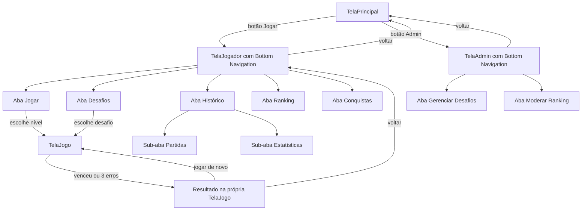

# Sudoku Kotlin | Plano do Projeto e Divisão de Tarefas

Trabalho final de Desenvolvimento de Aplicativos Móveis. Grupo de 6 pessoas.
Kotlin + Jetpack Compose + MVVM + Room + Firebase Firestore.

Entrega: repositório no GitHub com commits de todos, README com prints e vídeo, defesa individual entre 13 e 19/11.

Padrão de código: **o mesmo da "Aula Banco / banco-03-mvvm / versao_final_mvvm"** (CRUD de Filmes em MVVM) para tudo que é dado e ViewModel, e o da **"Aula 13 / versao_final"** para a navegação.

**Divisão por funcionalidade**: cada pessoa é dona de uma funcionalidade inteira, da tela até o Repository.

- **Não tem login.** A tela inicial tem só dois botões, "Jogar" e "Admin". Isso não é funcionalidade de ninguém.
- **O banco de dados não conta nota.** Entidades, DAOs e AppDatabase são montados juntos no primeiro dia e todo mundo usa.

---

## 1. A ideia em um parágrafo

Um Sudoku com **3 níveis**, e o nível muda o **tamanho** do tabuleiro: Fácil é 4x4, Médio é 6x6 e Difícil é 9x9. Todo jogo é **gerado na hora**, sempre diferente. As partidas ficam salvas no celular (Room), com histórico, estatísticas e **conquistas** que vão sendo desbloqueadas. Na área do **Admin**, dá para criar **Desafios** no Firebase (um desafio é um Sudoku "fixo", igual para todo mundo) e moderar o **Ranking Global**, que também fica no Firebase.

---

## 2. Regras do jogo (mecânicas simples de propósito)

| Nível | Tabuleiro | Blocos | Números | Casas vazias | Dicas |
|---|---|---|---|---|---|
| Fácil | 4x4 | 2x2 | 1 a 4 | 8 de 16 | 3 |
| Médio | 6x6 | 2 linhas x 3 colunas | 1 a 6 | 18 de 36 | 2 |
| Difícil | 9x9 | 3x3 | 1 a 9 | 45 de 81 | 1 |

- O jogador toca numa casa vazia e depois num número do teclado.
- **Erro**: o número colocado repete na mesma linha, coluna ou bloco. A casa fica vermelha e conta 1 erro.
- **3 erros = derrota.**
- **Vitória**: todas as casas preenchidas e nenhum conflito.
- **Dica**: preenche uma casa vazia com o número certo (vem do gabarito guardado na geração).
- **Apagar**: limpa a casa selecionada (só as que o jogador preencheu).
- **Cronômetro** contando desde o início.
- **Pontuação** no fim: `base do nível - segundos - 50 x erros - 100 x dicas usadas`, nunca abaixo de 0. Base: Fácil 1000, Médio 2000, Difícil 3000.

Por que a regra de erro é "conflito" e não "diferente do gabarito": o gerador não garante solução única, então um número pode ser válido mesmo sendo diferente do gabarito. Checar conflito é mais simples e nunca pune jogada válida.

---

## 3. Como o gerador funciona (sem algoritmo complicado)

Nada de backtracking. São 3 passos, todos com funções de lista do Kotlin:

1. **Monta um Sudoku resolvido com uma fórmula.** Com `N` = tamanho, `BL` = linhas do bloco e `BC` = colunas do bloco, a casa da linha `l` e coluna `c` recebe:
   `(BC * (l % BL) + l / BL + c) % N + 1`
   Isso já gera um Sudoku válido, só que sempre igual.
2. **Embaralha sem quebrar as regras.** Embaralhar linhas dentro da mesma faixa de blocos, embaralhar as faixas entre si, fazer o mesmo com as colunas, e trocar os números entre si (ex.: todo 1 vira 3, todo 3 vira 2...). Tudo com `shuffled()`. O resultado continua válido e fica aleatório.
3. **Esvazia casas.** Sorteia as posições e apaga a quantidade de casas do nível.

Para os **Desafios**, o gerador recebe um `Random(semente)` em vez de `Random()`. Mesma semente = mesmo Sudoku para todo mundo. É só isso que faz o desafio ser "fixo".

> A ideia foi testada com 2.000 tabuleiros de cada tamanho (4x4, 6x6, 9x9) e todos saíram válidos.

---

## 4. As 6 funcionalidades (resumo da divisão)

| Pessoa | Quem (sorteio) | Funcionalidade | Telas | ViewModels | Dificuldade |
|---|---|---|---|---|---|
| **P1** | **Marcos** | **Conquistas** + estrutura de navegação | Aba Conquistas, Bottom Navs | ConquistasViewModel | Média |
| **P2** | **Dombrosk** | **Gerador e Novo Jogo** | Aba Jogar, componentes Tabuleiro e Teclado | NovoJogoViewModel | Alta (lógica) |
| **P3** | **Eduardo** | **Partida (o jogo em si)** | TelaJogo + Resultado | JogoViewModel | **A mais alta** |
| **P4** | **Arthur** | **Histórico e Estatísticas** | Aba Histórico (sub-abas Partidas e Estatísticas) | HistoricoViewModel, EstatisticasViewModel | Média-alta |
| **P5** | **Mariana** | **Desafios** (jogador + admin) | Aba Desafios, Aba Gerenciar Desafios | DesafiosViewModel, AdminDesafiosViewModel | Média-alta |
| **P6** | **Gabriel** | **Ranking Global** (jogador + admin) | Aba Ranking, Aba Moderar Ranking com painel | RankingViewModel, AdminRankingViewModel | Média-alta |

9 ViewModels no total (o mínimo é 2). **Todo mundo tem pelo menos um pacote `ui/...` completo** (UiState + ViewModel + Factory + Tela) e um Repository com try-catch para defender.

As funcionalidades foram distribuídas por sorteio em 05/11/2026.

---

## 5. O padrão MVVM da aula (todo mundo segue igual)

| No exemplo da aula | No Sudoku |
|---|---|
| `data/local/Filmes.kt` (`@Entity`, `id: Int = 0`) | `Partida.kt`, `Conquista.kt` |
| `data/local/FilmesDAO.kt` (`inserir`, `atualizar`, `deletar` com `suspend`; `buscarTodos()` devolvendo `Flow`) | `PartidaDAO.kt`, `ConquistaDAO.kt` com os mesmos nomes |
| `data/local/AppDatabase.kt` (singleton `getDatabase`) | `AppDatabase.kt` com as 2 entidades |
| `data/repository/FilmesRepository.kt` (recebe o DAO; `getAllFilmes`, `inserir`, `atualizar`, `deletar`) | Um Repository por fonte: `PartidaRepository`, `ConquistaRepository`, `DesafioRepository`, `RankingRepository` |
| `ui/filmes/` com **4 arquivos**: `FilmesUiState`, `FilmesViewModel`, `FilmesViewModelFactory`, `TelaCadastroFilmes` | **Um pacote por funcionalidade** em `ui/`, com UiState, ViewModel, Factory e Tela de cada tela |
| `MutableStateFlow` privado + `StateFlow` público + `_uiState.update { it.copy(...) }` | igual em todos os ViewModels |
| Flow coletado **uma vez** no `init {}` | igual (Room). No Firebase, `init {}` chama `carregar()` |
| Funções de evento com nome `onAlgumaCoisa` (`onNomeChange`, `onSave`, `onEdit`, `onDelete`) | igual |
| UiState com propriedade calculada (`textoBotao`) | ex.: `tempoFormatado`, `textoBotao`, `textoListaVazia` |
| Tela cria o ViewModel no parâmetro: `viewModel(factory = XViewModelFactory(XRepository(...)))` e lê com `collectAsStateWithLifecycle()` | igual em todas as telas |
| Tela "burra", item da lista num composable `UmFilme(...)` | `UmaPartida`, `UmDesafio`, `UmItemRanking`, `UmaConquista` |

**Duas coisas que a aula não tinha e o trabalho exige:**

1. **try-catch no Repository** (requisito "Tratamento de Exceções"). Usamos uma `sealed class Resultado` para o erro chegar no UiState (seção 9).
2. **Navegação**: juntamos com o padrão da Aula 13 (`Rotas`, `AppNavigation`, tela com `BottomNavBar` e NavHost interno). A diferença é que **não criamos ViewModel no AppNavigation**: cada tela cria o seu pela Factory, como na Aula Banco. O que a tela precisa saber (nível, semente) chega **pela rota** e é passado para a **Factory**.

---

## 6. Planejamento visual: telas e navegação

### Fluxo por perfil



### Rotas (padrão da Aula 13)

| Rota | Tela | Argumentos |
|---|---|---|
| `home` | TelaPrincipal (2 botões) | |
| `jogador` | TelaJogador (5 abas) | |
| `jogo/{nivel}/{semente}` | TelaJogo | semente `0` = jogo aleatório |
| `admin` | TelaAdmin (2 abas) | |

Abas (`RotasAbas`, igual à aula 13): do jogador `aba_jogar`, `aba_desafios`, `aba_historico`, `aba_ranking`, `aba_conquistas`; do admin `aba_admin_desafios`, `aba_admin_ranking`.

### Lista de telas (12 destinos, o mínimo pedido é 6)

| # | Tela | Perfil | Dono | O que tem |
|---|---|---|---|---|
| 1 | TelaPrincipal | todos | P1 | Nome do app e dois botões: Jogar e Admin |
| 2 | TelaJogador | jogador | P1 | Scaffold + TopAppBar + BottomNav com 5 abas (igual `TelaComAbas` da aula) |
| 3 | TelaAdmin | admin | P1 | Scaffold + TopAppBar + BottomNav com 2 abas |
| 4 | Aba Conquistas | jogador | P1 | Grade de medalhas com progresso, filtro desbloqueadas/bloqueadas |
| 5 | Aba Jogar | jogador | P2 | 3 cards de nível com recorde e quantidade de partidas de cada um |
| 6 | TelaJogo | jogador | P3 | Tabuleiro, teclado, cronômetro, erros, dicas. No fim mostra o resultado |
| 7 | Sub-aba Partidas | jogador | P4 | Lista com filtros, ordenação, favoritar, excluir, limpar histórico |
| 8 | Sub-aba Estatísticas | jogador | P4 | Vitórias, % de vitória, melhor tempo e média de pontos por nível |
| 9 | Aba Desafios | jogador | P5 | Desafios do Firebase com "já jogado" e melhor pontuação |
| 10 | Aba Gerenciar Desafios | admin | P5 | **Igual à TelaCadastroFilmes**: formulário em cima, lista com editar/excluir embaixo |
| 11 | Aba Ranking | jogador | P6 | Top 20 global, filtro por nível, busca por nome |
| 12 | Aba Moderar Ranking | admin | P6 | Painel de estatísticas por nível + lista com excluir |

### Rascunho da TelaJogo (9x9)

```
+--------------------------------------+
| <-  Difícil 9x9          03:42       |  TopAppBar
+--------------------------------------+
| Erros: 1/3            Dicas: 1       |
|                                      |
|  5 3 . | . 7 . | . . .               |
|  6 . . | 1 9 5 | . . .               |  TabuleiroSudoku
|  . 9 8 | . . . | . 6 .               |  (casa selecionada destacada,
|  ------+-------+------               |   erro em vermelho,
|  ...                                 |   fixas em negrito)
|                                      |
|  [1] [2] [3] [4] [5] [6] [7] [8] [9] |  TecladoNumerico
|      [ Apagar ]      [ Dica ]        |
+--------------------------------------+
```

### Rascunho da Aba Conquistas

```
+--------------------------------------+
|  Conquistas: 4 de 10                 |
|  (Todas) (Desbloqueadas) (Bloqueadas)|
|                                      |
|  +-----------+   +-----------+       |
|  |   [*]     |   |   [ ]     |       |  LazyVerticalGrid
|  | Primeira  |   | Mestre    |       |  com UmaConquista
|  | vitória   |   | 9x9       |       |
|  | 12/11     |   | 0/1       |       |  data ou progresso
|  +-----------+   +-----------+       |
|  |   [ ]     |   |   [*]     |       |
|  | Maratona  |   | Perfeito  |       |
|  | ====--  7/10  | 12/11     |       |  barra de progresso
|  +-----------+   +-----------+       |
+--------------------------------------+
```

### Rascunho da Aba Gerenciar Desafios (admin)

```
+--------------------------------------+
|  +--------------------------------+  |
|  | Nome: [Desafio da semana_____] |  |  Card de formulário
|  | Nível: (Fácil) (Médio) (Difícil)| |  (igual TelaCadastroFilmes)
|  | Semente: [48213] [Sortear]     |  |
|  | Ativo: [x]                     |  |
|  |            [ Criar desafio ]   |  |  textoBotao calculado
|  +--------------------------------+  |
|  Desafio da semana  Médio   [E] [X]  |  LazyColumn com UmDesafio
|  Desafio relâmpago  Fácil   [E] [X]  |
+--------------------------------------+
```

---

## 7. Estrutura de pacotes por funcionalidade

Pacote base: `com.example.sudoku`. Igual à aula: `data/local`, `data/repository`, e um pacote em `ui/` por funcionalidade com UiState + ViewModel + Factory + Tela juntos. Acrescentamos `data/remote` (Firebase) e `logic` (regras do Sudoku e das conquistas).

```
com.example.sudoku/
├── MainActivity.kt                              P1
│
├── logic/
│   ├── Nivel.kt                                 P2
│   ├── GeradorSudoku.kt                         P2
│   ├── ValidadorSudoku.kt                       P2
│   ├── Pontuacao.kt                             P2
│   └── RegrasConquistas.kt                      P1
│
├── data/
│   ├── local/                                   montado juntos no dia 1 (não conta nota)
│   │   ├── Partida.kt
│   │   ├── PartidaDAO.kt
│   │   ├── Conquista.kt
│   │   ├── ConquistaDAO.kt
│   │   └── AppDatabase.kt
│   ├── remote/
│   │   ├── DesafioRemoto.kt                     P5
│   │   ├── DesafiosFirestore.kt                 P5
│   │   ├── RankingRemoto.kt                     P6
│   │   └── RankingFirestore.kt                  P6
│   └── repository/
│       ├── Resultado.kt                         P1
│       ├── ConquistaRepository.kt               P1
│       ├── PartidaRepository.kt                 P4
│       ├── DesafioRepository.kt                 P5
│       └── RankingRepository.kt                 P6
│
└── ui/
    ├── navegacao/                               P1
    │   ├── Rotas.kt
    │   ├── AppNavigation.kt
    │   ├── TelaPrincipal.kt
    │   ├── TelaJogador.kt
    │   ├── BottomNavBar.kt
    │   └── TelaAdmin.kt
    ├── conquistas/                              P1
    │   ├── ConquistasUiState.kt
    │   ├── ConquistasViewModel.kt
    │   ├── ConquistasViewModelFactory.kt
    │   └── AbaConquistas.kt
    ├── novojogo/                                P2
    │   ├── NovoJogoUiState.kt
    │   ├── NovoJogoViewModel.kt
    │   ├── NovoJogoViewModelFactory.kt
    │   ├── AbaJogar.kt
    │   ├── TabuleiroSudoku.kt
    │   └── TecladoNumerico.kt
    ├── jogo/                                    P3
    │   ├── JogoUiState.kt
    │   ├── JogoViewModel.kt
    │   ├── JogoViewModelFactory.kt
    │   ├── TelaJogo.kt
    │   └── ResultadoJogo.kt
    ├── historico/                               P4
    │   ├── AbaHistorico.kt
    │   ├── HistoricoUiState.kt
    │   ├── HistoricoViewModel.kt
    │   ├── HistoricoViewModelFactory.kt
    │   ├── ListaPartidas.kt
    │   ├── EstatisticasUiState.kt
    │   ├── EstatisticasViewModel.kt
    │   ├── EstatisticasViewModelFactory.kt
    │   └── PainelEstatisticas.kt
    ├── desafios/                                P5
    │   ├── DesafiosUiState.kt
    │   ├── DesafiosViewModel.kt
    │   ├── DesafiosViewModelFactory.kt
    │   ├── AbaDesafios.kt
    │   ├── AdminDesafiosUiState.kt
    │   ├── AdminDesafiosViewModel.kt
    │   ├── AdminDesafiosViewModelFactory.kt
    │   └── AbaGerenciarDesafios.kt
    └── ranking/                                 P6
        ├── RankingUiState.kt
        ├── RankingViewModel.kt
        ├── RankingViewModelFactory.kt
        ├── AbaRanking.kt
        ├── AdminRankingUiState.kt
        ├── AdminRankingViewModel.kt
        ├── AdminRankingViewModelFactory.kt
        └── AbaModerarRanking.kt

test/
├── GeradorSudokuTest.kt                         P2
└── RegrasConquistasTest.kt                      P1
```

---

## 8. Dados

### Banco local (Room): montado juntos no dia 1

Como o banco não conta nota, ele não é a parte de ninguém. No primeiro dia, em uma chamada de ~1h, o grupo monta as 2 entidades, os 2 DAOs e o `AppDatabase` copiando o modelo da aula, sobe na `main`, e cada um usa pelo Repository da sua funcionalidade. Quem precisar de uma consulta nova no DAO só acrescenta a função.

**Partida** (tabela `partidas`): `id: Int = 0` (autoGenerate), `nivel: String` ("FACIL", "MEDIO", "DIFICIL"), `venceu: Boolean`, `tempoSegundos: Int`, `erros: Int`, `dicasUsadas: Int`, `pontos: Int`, `semente: Long` (0 = jogo aleatório, outro valor = desafio), `favorita: Boolean = false`, `data: Long`.

**Conquista** (tabela `conquistas`): `codigo: String` (`@PrimaryKey`, ex.: "PRIMEIRA_VITORIA"), `desbloqueadaEm: Long`, `vista: Boolean = false`. Só as conquistas desbloqueadas ficam salvas; a lista completa (título, descrição, regra) fica no código, em `RegrasConquistas`.

| PartidaDAO | ConquistaDAO |
|---|---|
| `suspend fun inserir(partida)` | `suspend fun inserir(conquista)` (ignora se já existe) |
| `fun buscarTodos(): Flow<List<Partida>>` | `fun buscarTodos(): Flow<List<Conquista>>` |
| `suspend fun buscarTodosAgora(): List<Partida>` | |
| `suspend fun atualizar(partida)` | `suspend fun atualizar(conquista)` |
| `suspend fun deletar(partida)` | `suspend fun deletarTodos()` |
| `suspend fun deletarTodos()` | |

**CRUD** (o requisito continua valendo, só não é a parte de ninguém):

| | Partida | Conquista |
|---|---|---|
| Create | Fim do jogo salva (P3) | Desbloquear ao terminar uma partida (P1, chamado pela P3) |
| Read (Flow) | Histórico, Estatísticas (P4), recordes da Aba Jogar (P2), status dos Desafios (P5), progresso das Conquistas (P1) | Aba Conquistas e o aviso na Bottom Nav (P1) |
| Update | Favoritar no Histórico (P4) | Marcar como vista ao abrir a aba (P1) |
| Delete | Excluir partida e limpar histórico (P4) | Resetar conquistas (P1) |

### Firebase Firestore (nuvem): 2 coleções

Os arquivos `DesafiosFirestore` e `RankingFirestore` fazem para o Firebase o mesmo papel que o DAO faz para o Room (`buscarTodos`, `inserir`, `atualizar`, `deletar`), e o Repository recebe eles no construtor do mesmo jeito que recebe o DAO.

**desafios** (P5): `id: String` (`@DocumentId`), `nome`, `nivel`, `semente: Long`, `ativo: Boolean`.

**ranking** (P6): `id: String` (`@DocumentId`), `nomeJogador` (digitado na hora de publicar), `nivel`, `pontos: Int`, `tempoSegundos: Int`, `data: Long`.

Todos os campos com valor padrão (`= ""`, `= 0`), senão o Firestore não consegue converter o documento em objeto.

O Room devolve `Flow` e a lista se atualiza sozinha. O Firestore aqui é lido com `get()` (uma vez só), então depois de salvar ou excluir o ViewModel chama `carregar()` de novo.

---

## 9. Modelo de código que todo mundo copia

Exemplo completo de uma funcionalidade, seguindo **exatamente** a estrutura do `ui/filmes` da aula. Só muda o nome das coisas em cada pacote.

### `data/repository/Resultado.kt` (P1, usado por todos)

```kotlin
sealed class Resultado<out T> {
    data class Sucesso<T>(val dados: T) : Resultado<T>()
    data class Erro(val mensagem: String) : Resultado<Nothing>()
}
```

### `data/repository/PartidaRepository.kt` (igual ao FilmesRepository + try-catch)

```kotlin
class PartidaRepository(private val partidaDao: PartidaDAO) {

    fun getAllPartidas(): Flow<Resultado<List<Partida>>> =
        partidaDao.buscarTodos()
            .map<List<Partida>, Resultado<List<Partida>>> { Resultado.Sucesso(it) }
            .catch { emit(Resultado.Erro("Não foi possível carregar o histórico")) }

    suspend fun inserir(partida: Partida): Resultado<Unit> =
        try {
            partidaDao.inserir(partida)
            Resultado.Sucesso(Unit)
        } catch (e: Exception) {
            Resultado.Erro("Não foi possível salvar a partida")
        }

    suspend fun atualizar(partida: Partida): Resultado<Unit> =
        try {
            partidaDao.atualizar(partida)
            Resultado.Sucesso(Unit)
        } catch (e: Exception) {
            Resultado.Erro("Não foi possível atualizar a partida")
        }

    suspend fun deletar(partida: Partida): Resultado<Unit> =
        try {
            partidaDao.deletar(partida)
            Resultado.Sucesso(Unit)
        } catch (e: Exception) {
            Resultado.Erro("Não foi possível excluir a partida")
        }
}
```

### `ui/historico/HistoricoUiState.kt`

```kotlin
data class HistoricoUiState(
    val listaDePartidas: List<Partida> = emptyList(),
    val filtroNivel: Nivel? = null,
    val soVitorias: Boolean = false,
    val partidaExpandidaId: Int? = null,
    val erro: String? = null
) {
    val textoListaVazia: String
        get() = if (filtroNivel == null) "Você ainda não jogou nenhuma partida"
        else "Nenhuma partida no nível ${filtroNivel.titulo}"
}
```

### `ui/historico/HistoricoViewModel.kt`

```kotlin
class HistoricoViewModel(
    private val repository: PartidaRepository
) : ViewModel() {

    private val _uiState = MutableStateFlow(HistoricoUiState())
    val uiState: StateFlow<HistoricoUiState> = _uiState.asStateFlow()

    private var todasAsPartidas: List<Partida> = emptyList()

    init {
        viewModelScope.launch {
            repository.getAllPartidas().collect { resultado ->
                when (resultado) {
                    is Resultado.Sucesso -> {
                        todasAsPartidas = resultado.dados
                        aplicarFiltros()
                    }
                    is Resultado.Erro -> _uiState.update { it.copy(erro = resultado.mensagem) }
                }
            }
        }
    }

    fun onFiltroNivelChange(nivel: Nivel?) {
        _uiState.update { it.copy(filtroNivel = nivel) }
        aplicarFiltros()
    }

    fun onFavoritar(partida: Partida) {
        viewModelScope.launch {
            val resultado = repository.atualizar(partida.copy(favorita = !partida.favorita))
            if (resultado is Resultado.Erro) _uiState.update { it.copy(erro = resultado.mensagem) }
        }
    }

    fun onDelete(partida: Partida) {
        viewModelScope.launch {
            val resultado = repository.deletar(partida)
            if (resultado is Resultado.Erro) _uiState.update { it.copy(erro = resultado.mensagem) }
        }
    }

    private fun aplicarFiltros() {
        val estado = _uiState.value
        val lista = todasAsPartidas
            .filter { estado.filtroNivel == null || it.nivel == estado.filtroNivel.name }
            .filter { !estado.soVitorias || it.venceu }
            .sortedByDescending { it.data }
        _uiState.update { it.copy(listaDePartidas = lista) }
    }
}
```

### `ui/historico/HistoricoViewModelFactory.kt`

```kotlin
class HistoricoViewModelFactory(
    private val repository: PartidaRepository
) : ViewModelProvider.Factory {

    override fun <T : ViewModel> create(modelClass: Class<T>): T {
        if (modelClass.isAssignableFrom(HistoricoViewModel::class.java)) {
            @Suppress("UNCHECKED_CAST")
            return HistoricoViewModel(repository) as T
        }
        throw IllegalArgumentException("Unknown ViewModel class")
    }
}
```

### `ui/historico/ListaPartidas.kt`

```kotlin
@Composable
fun ListaPartidas(
    viewModel: HistoricoViewModel = viewModel(
        factory = HistoricoViewModelFactory(
            PartidaRepository(AppDatabase.getDatabase(LocalContext.current).partidaDAO())
        )
    )
) {
    val uiState by viewModel.uiState.collectAsStateWithLifecycle()

    LazyColumn(verticalArrangement = Arrangement.spacedBy(8.dp)) {
        items(uiState.listaDePartidas) { partida ->
            UmaPartida(
                partida = partida,
                onFavoritar = { viewModel.onFavoritar(partida) },
                onDelete = { viewModel.onDelete(partida) }
            )
        }
    }
}
```

**Regras que valem para todos:**

- A tela nunca chama DAO, Firestore, `CoroutineScope` ou `Dispatchers.IO`. Só lê `uiState` e chama `viewModel.onAlgumaCoisa()`.
- O ViewModel nunca recebe exceção: quem faz try-catch é o Repository, e o erro chega como `Resultado.Erro` e vira `uiState.erro`.
- Toda tela mostra `uiState.erro` quando não for nulo (Text vermelho ou Snackbar).
- Toda tela tem um `@Preview`.

---

## 10. Divisão de tarefas por funcionalidade

### P1 | Conquistas (+ estrutura de navegação) | Marcos

**Telas:** Aba Conquistas, e a estrutura do app (TelaPrincipal, TelaJogador e TelaAdmin com as Bottom Navs).

**Como funciona:** o app tem uma lista fixa de ~10 conquistas. Cada uma tem uma regra que olha a lista de partidas e diz o progresso. Quando o progresso chega na meta, a conquista é desbloqueada e salva no Room com a data.

| Conquista | Regra | Meta |
|---|---|---|
| Primeira vitória | vitórias | 1 |
| Perfeito | vitórias com 0 erros | 1 |
| Sem ajuda | vitórias com 0 dicas | 1 |
| Relâmpago | vitória no Fácil em menos de 60s | 1 |
| Mestre 9x9 | vitórias no Difícil | 1 |
| Explorador | níveis diferentes vencidos | 3 |
| Maratona | partidas jogadas | 10 |
| Em chamas | vitórias seguidas | 3 |
| Desafiante | desafios vencidos (`semente != 0`) | 1 |
| Colecionador | soma de pontos | 10.000 |

**Faz:**
- Cria o projeto no Android Studio, o repositório no GitHub, adiciona os 6 como colaboradores, configura o `build.gradle` (seção 13), cria os pacotes vazios e o `Resultado.kt` no dia 1.
- `ui/navegacao`: `MainActivity`, `Rotas` (`Rotas`, `RotasAbas`, com `fun jogo(nivel: Nivel, semente: Long)`), `AppNavigation`, `TelaPrincipal` (dois botões), `TelaJogador` + `BottomNavBarJogador` (5 abas) e `TelaAdmin` + `BottomNavBarAdmin` (2 abas), as duas barras em `BottomNavBar.kt`, igual à aula 13. A aba Conquistas mostra um aviso (`BadgedBox`) quando tem conquista nova não vista.
- `logic/RegrasConquistas.kt`: `data class RegraConquista(val codigo: String, val titulo: String, val descricao: String, val meta: Int, val progresso: (List<Partida>) -> Int)`. **A regra é uma lambda guardada dentro do objeto.** Exemplos:
  - Perfeito: `{ partidas -> partidas.count { it.venceu && it.erros == 0 } }`
  - Explorador: `{ partidas -> partidas.filter { it.venceu }.map { it.nivel }.distinct().size }`
  - Em chamas: `{ partidas -> partidas.sortedByDescending { it.data }.takeWhile { it.venceu }.size }`
  - Função `novasConquistas(partidas, jaDesbloqueadas): List<RegraConquista>` que devolve as que bateram a meta e ainda não estavam salvas.
- `ConquistaRepository` com try-catch: `getAll()`, `verificar()` (busca as partidas, chama `novasConquistas`, salva as novas e devolve a lista para a P3 mostrar no resultado), `marcarComoVistas()`, `resetar()`.
- **Conquistas** (`ConquistasUiState`, `ConquistasViewModel`, `ConquistasViewModelFactory`, `AbaConquistas`):
  - Junta dois Flows: partidas (para calcular o progresso) e conquistas salvas (para saber quais estão desbloqueadas e quando). Monta um `ConquistaItem(regra, progresso, desbloqueadaEm)` para cada regra com `map`.
  - `LazyVerticalGrid` com `UmaConquista`: ícone colorido ou cinza, título, descrição, barra de progresso (`LinearProgressIndicator`) ou data.
  - Contador "4 de 10", filtro (todas, desbloqueadas, bloqueadas), ordenação (desbloqueadas primeiro, depois as mais perto de completar com `sortedByDescending { it.progresso.toFloat() / it.meta }`).
  - Ao abrir a aba, marca as novas como vistas (Update). Botão "Resetar conquistas" com confirmação (Delete).
- `RegrasConquistasTest.kt`: testes JUnit das regras com listas de partidas inventadas.

**Kotlin que mostra:** lambdas guardadas em data class (função de ordem superior), `count`, `filter`, `map`, `distinct`, `takeWhile`, `sumOf`, `sortedByDescending`, juntar dois Flows, NavHost com argumentos e NavHost interno.

**Na defesa precisa saber explicar:** como uma regra que é uma lambda funciona; como o app descobre que uma conquista acabou de ser desbloqueada sem desbloquear duas vezes; como o progresso é calculado a partir das partidas; como o NavHost principal e o interno funcionam juntos e como a tela inicial separa o jogador do admin.

---

### P2 | Gerador e Novo Jogo | Dombrosk

**Telas:** Aba Jogar, e os componentes `TabuleiroSudoku` e `TecladoNumerico` (usados pela P3).

**Faz:**
- `logic/Nivel.kt`: `enum class Nivel(val tamanho, val linhasBloco, val colunasBloco, val casasVazias, val dicas, val pontosBase, val titulo)`.
- `logic/GeradorSudoku.kt`: `fun gerar(nivel: Nivel, random: Random): Sudoku` que devolve `tabuleiro` (zeros nas vazias) e `gabarito`. Os 3 passos da seção 3.
- `logic/ValidadorSudoku.kt`: `temConflito(tabuleiro, linha, coluna, nivel)`, `conflitos(tabuleiro, nivel): Set<Pair<Int, Int>>`, `estaCompleto(tabuleiro)`.
- `logic/Pontuacao.kt`: `calcular(nivel, segundos, erros, dicas): Int`.
- `GeradorSudokuTest.kt`: testes JUnit que geram 100 tabuleiros de cada nível e conferem linhas, colunas e blocos, e que a mesma semente gera o mesmo tabuleiro.
- **Novo Jogo** (`NovoJogoUiState`, `NovoJogoViewModel`, `NovoJogoViewModelFactory`, `AbaJogar`):
  - 3 cards de nível com tamanho, número de dicas e casas vazias (vêm do `Nivel`).
  - Em cada card: recorde de pontos, melhor tempo e quantas partidas foram jogadas naquele nível (`filter`, `maxOfOrNull`, `minOfOrNull`, `count`).
  - Nível selecionado destacado; botão Jogar navega para `jogo/{nivel}/0`.
- `TabuleiroSudoku.kt`: desenha N x N casas, borda grossa entre blocos (usa `linhasBloco`/`colunasBloco`), destaca selecionada, conflito em vermelho, fixas em negrito. Recebe tudo por parâmetro e avisa o clique com `onCasaClick: (Int, Int) -> Unit`.
- `TecladoNumerico.kt`: botões de 1 até N (muda com o nível), Apagar e Dica, avisando com `onNumeroClick: (Int) -> Unit`.

**Kotlin que mostra:** enum com propriedades, `shuffled`, `map`, `flatMap`, `all`, `distinct`, `Random(seed)`, `Pair`, funções puras, testes JUnit, componentes reutilizáveis.

**Na defesa precisa saber explicar:** por que a fórmula gera um Sudoku válido; por que embaralhar dentro da faixa não quebra as regras; como a semente faz o desafio ser igual para todos; como o tabuleiro sabe onde desenhar a borda grossa no 6x6.

---

### P3 | Partida (o jogo em si) | Eduardo

**Telas:** TelaJogo e o ResultadoJogo.

**Faz:**
- `JogoUiState`: tabuleiro, fixas, conflitos, selecionada, erros, dicasRestantes, segundos, status (EM_ANDAMENTO, VENCEU, PERDEU), pontos, nomeParaRanking, publicado, conquistasNovas, erro. Propriedades calculadas: `tempoFormatado` (mm:ss), `acabou`, `casasRestantes`.
- `JogoViewModel`:
  - No `init {}` gera o tabuleiro com o gerador da P2 (`Random(semente)` se for desafio, `Random` se a semente for 0) e liga o cronômetro com `viewModelScope.launch { while (...) { delay(1000) ... } }`.
  - `onCasaClick`: seleciona (não deixa selecionar casa fixa).
  - `onNumeroClick`: coloca o número, chama o Validador, conta erro, checa vitória e derrota.
  - `onApagar`, `onDica` (escolhe uma casa vazia com `filter` + `random()` e preenche com o gabarito).
  - Ao terminar: para o cronômetro, calcula pontos, salva a `Partida` com `PartidaRepository.inserir` e chama `ConquistaRepository.verificar()` (P1) para mostrar as conquistas novas.
  - `onNomeChange` e `onPublicarRanking()`: valida o nome (2 a 20 letras) e chama `RankingRepository.publicar` (P6). Só se venceu e só uma vez.
- `JogoViewModelFactory`: recebe os repositories + `nivel` e `semente` (vêm da rota).
- `TelaJogo`: TopAppBar com voltar e tempo, contadores, `TabuleiroSudoku` e `TecladoNumerico` da P2, confirmação ao sair no meio do jogo. Quando `uiState.acabou`, mostra o `ResultadoJogo`.
- `ResultadoJogo`: venceu/perdeu, tempo, pontos com o cálculo detalhado, conquistas desbloqueadas nessa partida, campo de nome + "Publicar no ranking", "Jogar de novo", "Voltar".

**Kotlin que mostra:** máquina de estados com enum, `copy` de data class e de matriz (`map { it.copyOf() }`), coroutines com `delay` e cancelamento, regra de negócio no ViewModel, Factory que recebe parâmetros além do Repository.

**Na defesa precisa saber explicar:** por que o cronômetro fica no ViewModel e não na tela (rotação); como uma jogada vira erro; o que acontece no 3º erro; como o nível e a semente chegam da rota até o ViewModel (pela Factory); por que precisa copiar o tabuleiro em vez de alterar ele direto.

---

### P4 | Histórico e Estatísticas | Arthur

**Telas:** Aba Histórico com 2 sub-abas (`TabRow`): Partidas e Estatísticas.

**Faz:**
- `PartidaRepository` com try-catch (é o modelo da seção 9).
- `AbaHistorico`: `TabRow` com as duas sub-abas.
- **Partidas** (`HistoricoUiState`, `HistoricoViewModel`, `HistoricoViewModelFactory`, `ListaPartidas`):
  - Coleta o Flow das partidas no `init {}`.
  - Filtros: nível, só vitórias, só favoritas, só desafios (`semente != 0`).
  - Ordenação: mais recente, menor tempo, mais pontos (`when` + `sortedBy` / `sortedByDescending`).
  - `UmaPartida` com estrela (favoritar = Update), lixeira (Delete) e toque que expande os detalhes.
  - "Limpar histórico" com confirmação.
- **Estatísticas** (`EstatisticasUiState`, `EstatisticasViewModel`, `EstatisticasViewModelFactory`, `PainelEstatisticas`):
  - Total de partidas, vitórias, % de vitória, sequência atual de vitórias.
  - Por nível: melhor tempo, média de pontos, total jogado (`groupBy { it.nivel }`, `average`, `minOfOrNull`).
  - Atualiza sozinho quando uma partida nova é salva (mesmo Flow).

**Kotlin que mostra:** Flow, try-catch, `filter`, `sortedBy`, `groupBy`, `mapValues`, `average`, `takeWhile`, dois ViewModels independentes.

**Na defesa precisa saber explicar:** por que a lista atualiza sozinha quando favorita ou exclui; onde está o try-catch e o que acontece se o banco falhar; como as estatísticas são calculadas a partir da lista.

---

### P5 | Desafios (jogador + admin) | Mariana

**Telas:** Aba Desafios (jogador) e Aba Gerenciar Desafios (admin).

**Faz:**
- Cria o projeto no Firebase, ativa o Firestore (modo teste), coloca o `google-services.json` no app e adiciona as dependências no dia 1 (assistente do Android Studio: Tools > Firebase > Cloud Firestore). A P6 usa a mesma configuração.
- `data/remote`: `DesafioRemoto` e `DesafiosFirestore` (`buscarTodos`, `inserir`, `atualizar`, `deletar` com `.await()`).
- `DesafioRepository` com try-catch e mensagem amigável quando está sem internet.
- **Gerenciar Desafios (admin)** (`AdminDesafiosUiState`, `AdminDesafiosViewModel`, `AdminDesafiosViewModelFactory`, `AbaGerenciarDesafios`): **é o CRUD de Filmes da aula aplicado aos desafios**.
  - Formulário com nome, nível, semente (botão "Sortear") e ativo.
  - `textoBotao` calculado ("Criar desafio" / "Salvar alterações"), `onEdit` preenche o formulário, `onSave` decide entre inserir e atualizar.
  - Validação: nome obrigatório e sem repetir, semente numérica e diferente de 0.
  - Confirmação antes de excluir.
- **Desafios (jogador)** (`DesafiosUiState`, `DesafiosViewModel`, `DesafiosViewModelFactory`, `AbaDesafios`):
  - Junta duas fontes: desafios do Firebase + partidas salvas no Room.
  - Para cada desafio mostra se já foi jogado e a melhor pontuação (`filter { it.ativo }`, `groupBy { it.semente }`, `map` para um `DesafioItem`).
  - Filtro "só os que ainda não joguei".
  - Botão Jogar navega para `jogo/{nivel}/{semente}`.

**Kotlin que mostra:** coroutines com `await`, CRUD remoto completo, validação no ViewModel, juntar duas fontes de dados com `map`/`groupBy`, dois ViewModels.

**Na defesa precisa saber explicar:** como `onSave` decide entre criar e editar (igual o `filmeEmEdicao` da aula); como o admin cria um desafio e ele aparece para o jogador; como o app sabe que um desafio já foi jogado; o que acontece sem internet.

---

### P6 | Ranking Global (jogador + admin) | Gabriel

**Telas:** Aba Ranking (jogador) e Aba Moderar Ranking (admin).

**Faz:**
- `data/remote`: `RankingRemoto` e `RankingFirestore`.
- `RankingRepository` com try-catch: `getRanking()`, `publicar(...)` (usado pela P3 no fim do jogo), `deletar`.
- **Ranking (jogador)** (`RankingUiState`, `RankingViewModel`, `RankingViewModelFactory`, `AbaRanking`):
  - Filtro por nível e busca por nome.
  - Ordena por pontos e desempata pelo menor tempo (`sortedWith(compareByDescending<RankingRemoto> { it.pontos }.thenBy { it.tempoSegundos })`), top 20 (`take(20)`), posição com `mapIndexed`.
  - 1º, 2º e 3º com destaque.
  - Erro sem internet com botão "Tentar de novo".
- **Moderar Ranking (admin)** (`AdminRankingUiState`, `AdminRankingViewModel`, `AdminRankingViewModelFactory`, `AbaModerarRanking`):
  - Painel por nível: total de registros, média de pontos, melhor tempo e o nome que mais aparece (`groupBy`, `average`, `minOf`, `maxByOrNull`).
  - Lista com filtro por nível e busca por nome, botão excluir com confirmação.

**Kotlin que mostra:** `sortedWith` com `compareBy`, `take`, `mapIndexed`, `groupBy`, `average`, `maxByOrNull`, coroutines com `await`, dois ViewModels.

**Na defesa precisa saber explicar:** como o ranking é ordenado e desempatado; como o resultado sai do jogo e chega no Firebase; por que o jogador só lê e o admin pode excluir; o que acontece sem internet.

---

### Tarefas de todos

- Montar juntos o banco (entidades, DAOs, AppDatabase) no dia 1.
- Cada um faz **seus próprios commits** na sua branch (o professor confere quem participou).
- Cada um tira **prints das suas telas** para o README e escreve **um parágrafo** sobre a sua funcionalidade.
- Todos rodam o app inteiro no emulador antes da entrega.

---

## 11. Ordem de trabalho (quem depende de quem)

| Peça "contrato" (dia 1) | Quem faz | Quem depende |
|---|---|---|
| Projeto, gradle, pacotes, repo GitHub, `Resultado.kt` | P1 | todos |
| `Rotas.kt` + `AppNavigation.kt` + Bottom Navs com telas vazias | P1 | todos |
| Entidades, DAOs e `AppDatabase` | todos juntos | todos |
| `PartidaRepository` | P4 | P1, P2, P3, P5 |
| `Nivel.kt` e assinatura do `GeradorSudoku.gerar` | P2 | P3, P5 |
| `TabuleiroSudoku` e `TecladoNumerico` (mesmo que feios no começo) | P2 | P3 |
| Assinatura do `ConquistaRepository.verificar` | P1 | P3 |
| Firebase configurado + `google-services.json` | P5 | P6 |
| Assinatura do `RankingRepository.publicar` | P6 | P3 |

Enquanto a peça de alguém não fica pronta, a pessoa testa a tela pelo `@Preview` com dados de mentira.

---

## 12. Cronograma (considerando apresentação a partir de 13/11)

| Quando | O quê |
|---|---|
| Qui 05/11 e Sex 06/11 | P1 cria projeto + repo + gradle. Chamada de ~1h para montar o banco juntos. Todos fazem os "contratos" da seção 11 e sobem. |
| Sáb 07/11 a Ter 10/11 | Cada um desenvolve sua funcionalidade na sua branch. |
| Qua 11/11 | Merge de tudo na `main`, integração, correção de bugs. |
| Qui 12/11 | Teste completo no emulador (roteiro da seção 14), prints, vídeo curto, README. |
| A partir de 13/11 | Link no Blackboard, apresentação e defesa individual. |

---

## 13. Configuração técnica (mesmas versões das aulas)

**`build.gradle` do projeto** (igual banco-02):
```kotlin
id("com.google.devtools.ksp") version "2.3.4" apply false
```

**`build.gradle` do módulo:**
```kotlin
plugins {
    id("com.google.devtools.ksp")
}

dependencies {
    val room_version = "3.0.3"
    implementation("androidx.room3:room3-runtime:$room_version")
    ksp("androidx.room3:room3-compiler:$room_version")

    implementation("androidx.lifecycle:lifecycle-viewmodel-ktx:2.9.4")
    implementation("androidx.lifecycle:lifecycle-viewmodel-compose:2.9.4")
    implementation("androidx.lifecycle:lifecycle-runtime-compose:2.9.4")

    implementation("androidx.navigation:navigation-compose:2.9.0")
    implementation("androidx.compose.material:material-icons-extended")
}
```

Mais o Firebase (o assistente do Android Studio adiciona): plugin `com.google.gms.google-services`, BoM do Firebase + `firebase-firestore`, e `kotlinx-coroutines-play-services` para usar `.await()`.

- Room é o **`androidx.room3`** (imports `androidx.room3.*`), igual às aulas.
- AGP `9.0.0` (o do Android Studio da sala), Gradle `9.3.1`, `compileSdk 37`, `minSdk 24`, Java 11.


### Convenções de código (para parecer um projeto só)

- Nomes em **português**, como nas aulas: `TelaX`, `AbaX`, `UmX` para item de lista, `Rotas`, `AppNavigation`.
- DAO e Repository com os nomes da aula: `inserir`, `buscarTodos`, `atualizar`, `deletar`, `getAllX`.
- ViewModel: `_uiState` privado + `uiState` público, `update { it.copy(...) }`, eventos `onX`.
- Tela: ViewModel no parâmetro com `viewModel(factory = ...)`, `collectAsStateWithLifecycle()`, `@Preview`.
- `Scaffold` + `TopAppBar` com as cores `MaterialTheme.colorScheme.primary`, igual às telas da aula 13.

---

## 14. Checklist dos requisitos do professor

| Requisito | Onde está | Quem |
|---|---|---|
| MVVM com 4+ pacotes | `ui`, `data.local`, `data.remote`, `data.repository`, `logic` | todos |
| Mínimo 2 ViewModels com UiState próprio | 9 ViewModels, cada um com `XUiState.kt` | todos |
| ViewModelFactory injetando Repository | uma Factory por ViewModel, igual à aula | todos |
| Repository com try-catch e erro no UiState | 4 Repositories + `Resultado` | P1, P4, P5, P6 |
| 2 @Entity no Room | `Partida`, `Conquista` | grupo |
| Flow do DAO coletado no ViewModel | Conquistas, Novo Jogo, Histórico, Estatísticas, Desafios | P1, P2, P4, P5 |
| CRUD completo | Partida (P3 cria, P4 lê/atualiza/exclui) e Conquista (P1) | P1, P3, P4 |
| Retrofit ou Firebase | Firestore: `desafios` e `ranking` | P5, P6 |
| Mínimo 6 telas | 12 destinos | todos |
| Bottom Navigation | Jogador (5 abas) e Admin (2 abas) | P1 |
| Filtros e ordenação com lambdas | Conquistas, Novo Jogo, Histórico, Estatísticas, Desafios, Ranking, Moderação | todos menos P3 |
| LazyColumn / LazyVerticalGrid | Histórico, Desafios, Gerenciar Desafios, Ranking, Moderação, Conquistas (grid) | vários |
| Controle de perfil Admin x Jogador | TelaPrincipal com dois botões leva a áreas diferentes; o jogador não vê nada do admin | P1 |

> Atenção: o slide do professor fala em bifurcação "com base no estado do usuário no ViewModel" e o exemplo dele usa tela de login. Vale confirmar com ele que dois botões no lugar do login estão ok.

### Roteiro de teste final (12/11)

1. Abrir o app, tocar em Jogar.
2. Jogar um Fácil até vencer; conferir pontos, a conquista "Primeira vitória" no resultado, o recorde na Aba Jogar e o registro no Histórico.
3. Jogar um Médio e errar 3 vezes; conferir derrota e as Estatísticas.
4. Jogar um Difícil, usar a dica, girar o celular no meio (o jogo e o tempo continuam).
5. Favoritar e excluir partida no Histórico; testar filtros e ordenação.
6. Digitar o nome, publicar no ranking e conferir na Aba Ranking.
7. Abrir Conquistas: conferir progresso, aviso de novas na Bottom Nav e o resetar.
8. Voltar, entrar como Admin, criar um desafio, voltar como jogador e jogar o desafio (2 celulares com a mesma semente veem o mesmo Sudoku); conferir "já jogado" na Aba Desafios.
9. Admin edita e exclui um desafio, confere o painel e exclui um item do ranking.
10. Desligar a internet do emulador e abrir Ranking/Desafios: deve aparecer mensagem de erro, sem fechar o app.

---

## 15. Git

- `main` protegida: ninguém commita direto, só via Pull Request.
- Uma branch por pessoa: `marcos-conquistas`, `dombrosk-gerador`, `eduardo-partida`, `arthur-historico`, `mariana-desafios`, `gabriel-ranking`.
- Commits pequenos e com mensagem clara (`Adiciona filtro por nível no histórico`).
- O `google-services.json` vai no repositório (o professor precisa rodar o projeto), com as regras do Firestore em modo teste.
- README final: o que é o app, como funciona, prints das telas, link do vídeo, integrantes e a funcionalidade de cada um.
